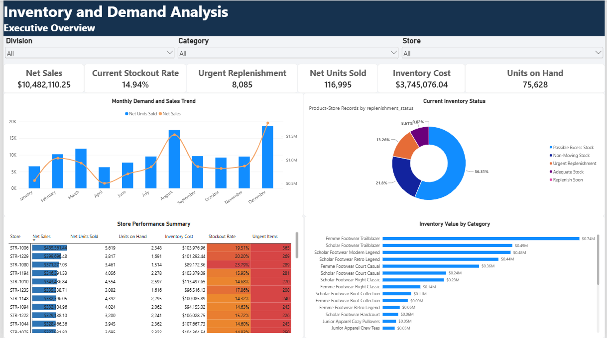
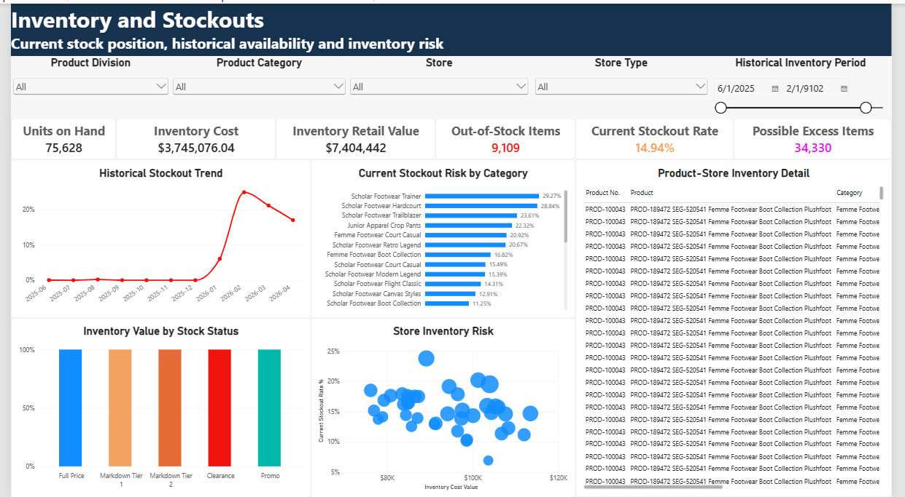
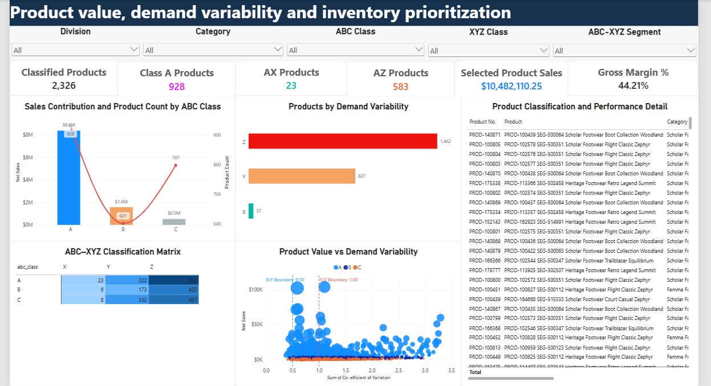
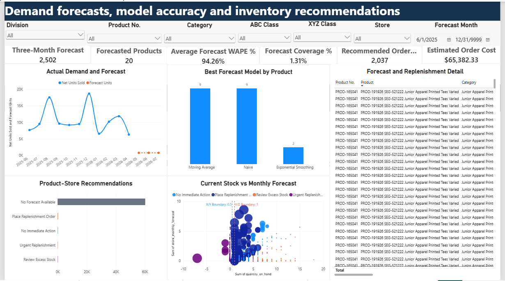

# Inventory and Demand Analysis Dashboard

An end-to-end business intelligence project that combines **Power Query, PostgreSQL, SQL, Python and Power BI** to analyse retail demand, inventory availability, product priorities, forecasts and replenishment opportunities.

The project demonstrates a complete analytics workflow: raw-data preparation, relational modelling, SQL analysis, ABC–XYZ classification, baseline demand forecasting, replenishment logic and interactive dashboard development.

## Project Overview

Retail organisations need to balance product availability against the cost of carrying too much stock. This project addresses that challenge by answering the following questions:

- Which products, categories and stores generate the strongest demand?
- Where are stockouts occurring, and how severe is the exposure?
- Which products are high value, stable, volatile or intermittent?
- Where could inventory be excessive or non-moving?
- Which product-store combinations require replenishment?
- How well do baseline forecasting models perform for priority products?

## Dashboard Preview

### Executive Overview



### Inventory and Stockouts



### Product and ABC–XYZ Analysis



### Forecasting and Replenishment



## Key Findings

- The dataset contains **125,751 sales records**, **284,755 inventory records**, **2,326 products** and **40 stores**.
- Net sales totalled **10,482,110.25 currency units**, with **116,995 net units sold** and a **44.21% gross margin**.
- December 2025 was the strongest month, generating **1,785,534.95** in net sales.
- The latest product-store snapshot contained **75,628 units on hand** with an inventory cost value of **3,745,076.04**.
- **9,109 of 60,968** latest product-store records were out of stock, producing a **14.94% current stockout rate**.
- Class A contained **928 products** and generated **79.99% of net sales**.
- The largest ABC–XYZ segment was **AZ**, containing **583 high-value, volatile products**.
- The forecasting proof of concept covered the top **20 Class A products** and forecast **2,502 units** for May–July 2026.
- The average best-model WAPE was **84.83%**, indicating that the baseline forecasts require further improvement before operational use.
- Forecast-supported urgent and place-order recommendations covered **446 product-store records**, with **1,174 suggested units** and an estimated cost of **32,404.06 currency units**.

See [the full analysis summary](documentation/analysis-summary.md) for detailed findings, assumptions and limitations.

## Analytical Workflow


## Tools and Techniques

### Power Query

- Data-type correction and column standardisation
- Return identification and calculated sales fields
- Calendar attributes and product-store keys
- Availability, stockout and inventory-period fields
- Duplicate and error checks

### PostgreSQL and SQL

- Data validation and missing-value checks
- Demand trends by month, product, category, channel and store
- Latest product-store inventory snapshots
- Stockout exposure and days-of-supply calculations
- Excess, non-moving and replenishment classifications
- Store-transfer candidate identification
- Reusable analytical views and performance indexes

### Python

- Exploratory data analysis with pandas
- ABC classification using cumulative net-sales contribution
- XYZ classification using monthly demand coefficient of variation
- Complete product-month grids including zero-demand months
- Naive, moving-average and simple exponential-smoothing forecasts
- MAE, RMSE, WAPE and forecast-bias evaluation
- Safety stock, reorder point and target-stock calculations
- Store allocation based on historical positive-demand share

### Power BI

- Star-schema semantic model
- Dedicated date, product and store dimensions
- DAX measures for demand, inventory, stockouts and forecasts
- Executive, inventory, product and forecasting report pages
- Slicers, navigation, conditional formatting and tooltips

## ABC–XYZ Methodology

### ABC classes

- **A:** approximately the first 80% of positive net sales
- **B:** approximately the next 15%
- **C:** the remaining contribution

### XYZ classes

- **X:** coefficient of variation at or below 0.50
- **Y:** coefficient of variation above 0.50 through 1.00
- **Z:** coefficient of variation above 1.00 or otherwise highly intermittent

Missing product-month combinations were filled with zero demand before variability was calculated so intermittent products were not incorrectly treated as stable.

## Forecasting and Replenishment Assumptions

- Forecasting was limited to the top 20 Class A products as a proof of concept.
- The final model for each product was selected primarily using the lowest WAPE.
- Replenishment calculations assumed a **14-day lead time** and **30-day target coverage**.
- Service factors varied by ABC class.
- Product forecasts were allocated to stores using historical positive-demand shares.
- Recommendations do not incorporate case-pack sizes, minimum order quantities, transfer costs or logistics capacity.

## Data-Quality Note

The inventory source contains **22,701 open-ended records with `9999-12-31` as an end-date sentinel**. This represents an active inventory record rather than a literal operational horizon. Closed inventory periods were therefore used for the historical stockout-day rate, while the latest product-store snapshot was used for current availability measures.

## Repository Structure

```text
inventory-demand-analysis/
├── data/
│   ├── raw/                         # Source data excluded from Git
│   └── processed/                   # Generated data excluded from Git
├── documentation/
│   ├── project-scope.md
│   └── analysis-summary.md
├── images/
│   ├── executive-overview.png
│   ├── inventory-stockouts.png
│   ├── product-abc-xyz-analysis.png
│   └── forecasting-replenishment.png
├── powerbi/
│   ├── inventory-demand-dashboard.pbix
│   └── inventory-demand-dashboard.pdf
├── python/
│   └── notebooks/
│       ├── 01_exploratory_data_analysis.ipynb
│       ├── 02_abc_xyz_analysis.ipynb
│       ├── 03_demand_forecasting.ipynb
│       └── 04_replenishment_recommendations.ipynb
├── sql/
│   ├── 00_create_indexes.sql
│   ├── 01_data_validation.sql
│   ├── 02_demand_analysis.sql
│   ├── 03_inventory_analysis.sql
│   └── 04_store_replenishment_analysis.sql
├── .gitignore
├── requirements.txt
└── README.md
```

## Running the Project

### 1. Obtain the dataset

Download the **Retail Transactions and Stocks Data** dataset from [Mendeley Data](https://data.mendeley.com/datasets/27x8mjm8k4/1) and place the source files in `data/raw/`.

Expected source files:

```text
retail_sales_ml_apl.csv
retail_inventory_ml_apl.csv
```

### 2. Prepare the data

Use the Power Query workflow described in the project documentation to generate:

```text
data/processed/sales_clean.csv
data/processed/inventory_clean.csv
```

### 3. Run the SQL analysis

Create the PostgreSQL tables, import the cleaned CSVs and execute the scripts in numerical order:

```text
00_create_indexes.sql
01_data_validation.sql
02_demand_analysis.sql
03_inventory_analysis.sql
04_store_replenishment_analysis.sql
```

### 4. Set up Python

```bash
python -m venv .venv
```

On Windows PowerShell:

```powershell
.venv\Scripts\Activate.ps1
pip install -r requirements.txt
```

Run the notebooks in numerical order. Each notebook produces outputs required by the next stage.

### 5. Open the dashboard

Open [inventory-demand-dashboard.pbix](powerbi/inventory-demand-dashboard.pbix) in Power BI Desktop. If necessary, update the CSV source paths in Power Query to match the local project directory.

A static PDF export is also available at [inventory-demand-dashboard.pdf](powerbi/inventory-demand-dashboard.pdf).

## Limitations

- The source currency was not explicitly confirmed, so financial findings are shown in currency units.
- Forecasts do not include promotions, holidays, pricing changes or external events.
- Supplier lead times, case-pack sizes and minimum order quantities were unavailable.
- Forecast coverage is intentionally limited and forecast accuracy is not yet suitable for automated ordering.
- Replenishment outputs are decision-support estimates rather than purchase orders.

## Dataset Attribution

This project uses the **Retail Transactions and Stocks Data** dataset, available from Mendeley Data under a CC BY 4.0 licence: [https://doi.org/10.17632/27x8mjm8k4.1](https://doi.org/10.17632/27x8mjm8k4.1).

## Author

**Sage Edgar Samuel**  
Data Analyst | Business Intelligence Analyst
